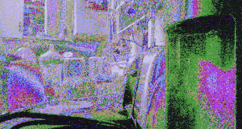
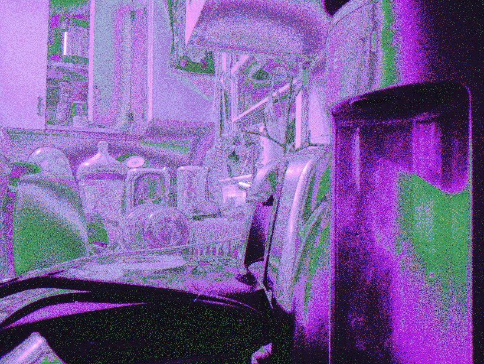
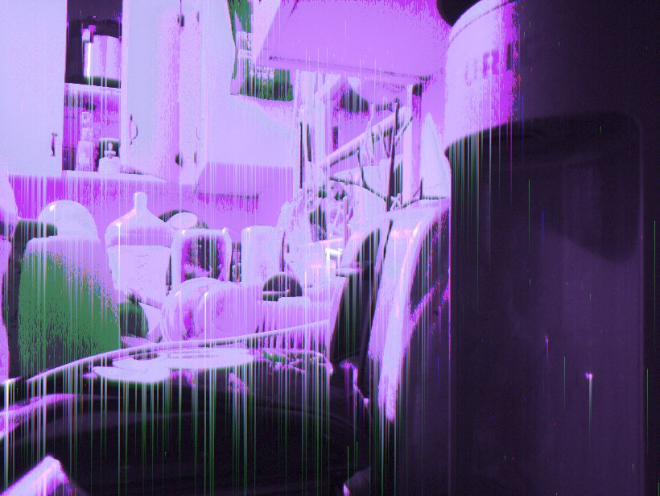
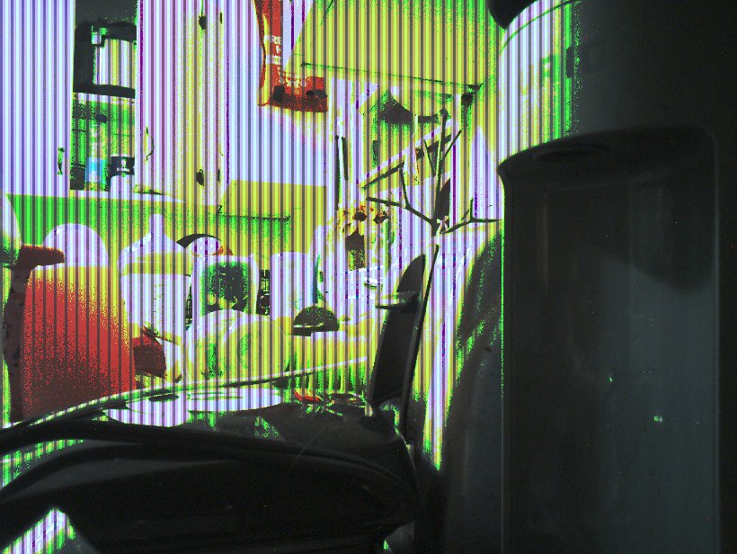
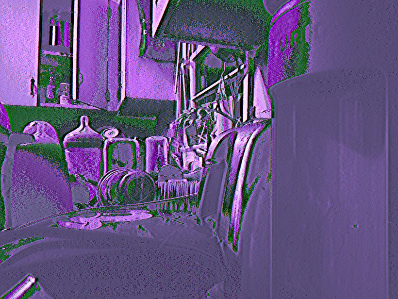
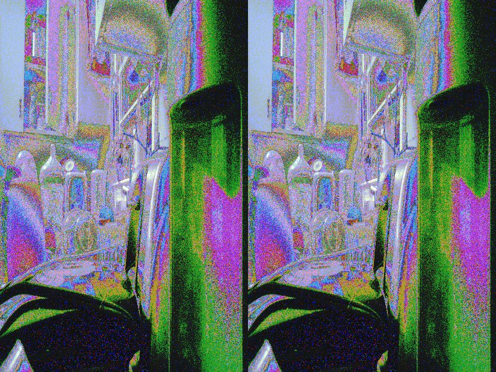

# GlitchCam

A glitch camera for the M5Stack CardputerZero. It takes the IMX219's raw Bayer
frames and decodes them wrong on purpose: bad stride, wrong bit depth, wrong Bayer
order, emulated bent ADC wires, flipped JPEG bytes, and H.264 with the keyframes
removed. Optionally it also bends the sensor's own registers over I2C.



*BEND on the device: wires 2, 0, 5, R and T connected one at a time, then
pulled again. [Full-quality video](docs/demo/demo.mp4).*

| | | |
|---|---|---|
|  |  |  |
| `2` + `0`: speckle, pink/green flip | `1` + `5` + `0`: posterized, dripping | `2` + `R`: speckle, wavy sync |
|  |  |  |
| `1` + `U`: column stripes | `6` + `0` + `W`: crossed bits, halo | `2` + `E`: speckle, doubled |

All shot as stills on the CardputerZero, 820×616 straight from the sensor.

## Install / remove

```bash
sudo ./install.sh
```

It shows up in the launcher as **GlitchCam**. If it doesn't, run
`systemctl --user restart APPLaunch`.

```bash
sudo /usr/share/APPLaunch/apps/glitchcam/uninstall.sh
```

Uninstalling removes the app, its icon and its launcher entry. Your photos and
clips in `~/Pictures/GlitchCam` are kept.

## Keys

The CardputerZero has no separate arrow or punctuation keys. The arrows are
the orange `fn` layer (`F` up, `X` down, `Z` left, `C` right), and the blue
`sym` layer holds `,` `/` `;` `.` on `V` `N` `A` `B`. A USB keyboard's real
arrow and punctuation keys work too.

| Key | Does |
|---|---|
| `fn`+`Z` / `fn`+`C` (or `sym`+`V` / `sym`+`N`) | previous / next glitch mode |
| `1`–`8` | jump to a mode (except in BEND, see below) |
| `fn`+`F` / `fn`+`X` (or `sym`+`A` / `sym`+`B`) | intensity up / down, 1–9 (each mode remembers its own; in BEND, the strength of the last wire you pressed) |
| `SPACE` / `ENTER` | take a still |
| `V` | start / stop a video clip (max 5 min) |
| `S` | stack the current mode, then pick another to layer on top |
| `C` | clear the stack |
| `1`–`9`, `0`, `Q`–`U` in BEND | **press** to connect that wire, press again to disconnect |
| `SHIFT`+ a wire key in BEND | **hold** to connect that wire only while the key is down |
| `Y` | arm / disarm SENSOR mode |
| `TAB` | hide / show the HUD |
| `H` | help |
| `ESC` | quit |

## Modes

| # | Mode | What breaks |
|---|---|---|
| 1 | CLEAN | nothing: plain raw decode |
| 2 | TEAR | wrong line stride in bands: tearing, shearing, smeared diagonals |
| 3 | DEPTH | 10-bit samples read at the wrong bit depth: values wrap into contour bands |
| 4 | SWAP | wrong Bayer order, R/B planes slip apart, LSB bytes leak in |
| 5 | BEND | circuit-bending emulation: ADC data bits bridged, stuck or crossed (B5–B9), VREF rainbow wrap, SHP sample-hold ghosts, ADCCK clock dropouts, XV smear, XSG row repeats. Each wire has its own strength; the HUD lists the connected wires |
| 6 | JPEG | bytes flipped inside the JPEG entropy data |
| 7 | MOSH | live: motion pushes stale pixels around. Clip: real H.264 with keyframes cut |
| 8 | SENSOR | **experimental**: writes IMX219 registers over I2C (digital gain, mirror/flip Bayer slip, readout skipping, CSI format, test patterns). Needs `Y` to arm |

Stacking: TEAR, DEPTH, SWAP and BEND all happen in a single pass over the raw
bytes. JPEG is applied after that, and MOSH last. SENSOR changes the sensor
itself, underneath everything else.

## BEND wires

GlitchCam starts in BEND with every wire disconnected, so the picture is
clean. BEND works like a bend box with sixteen wires: ten on the number row and six on `Q` `W` `E` `R` `T` `U`. The image gets every wire
that is connected right now:

- **Press:** a wire key connects that wire. Press it again to disconnect it.
  Wires stay connected until you press them again.
- **Hold:** `SHIFT`+ a wire key connects that wire only while the key is down,
  on top of the ones you've pressed on. Holding a wire that is already on
  changes nothing.
- **Strength:** every wire has its own strength, 1–9, starting at 5.
  `fn`+`F` / `fn`+`X` turn up or down the last wire you pressed on, like a
  knob that follows your hand. To go back to an earlier wire, press it twice
  (off, then on): it keeps its strength and the knob moves to it. Wires on
  data lines move to higher, harsher bits as you turn them up; the others
  grow in size, gain or reach.

Example: press `2`, then `fn`+`F` twice, and wire 2 is at strength 7. Press
`R`, then `fn`+`X`, and HSYNC is at 4 while wire 2 stays at 7. Holding
`SHIFT`+`7` on top adds wire 7 until you let go. Wires always apply in key
order, so the order you press them doesn't matter.

The top bar lists the connected wires with their strengths (`B8~B4:7
HSYNC:4`). The bottom bar has one bar per wire, as tall as its strength:
white for the one the knob is on, lit for connected, magenta for held. Next
to it, `R:4` names the knob's wire and strength.

The filename lists each connected wire's key followed by its strength, e.g.
`BEND_K27R4` for wire 2 at 7 and R at 4 (`BEND_OFF` for none).

The sensor gives each pixel as a 10-bit value (0–1023); bit 9 is the biggest
step in brightness.

| Wire | Imitates | Looks like |
|---|---|---|
| **B8~B7** (wire 1) | two high data lines shorted | if either bit is on, both are: mid-tones jump brighter in hard steps |
| **B8~B4** (wire 2) | a high data line shorted to a low one | bit 4 flickers with the sensor's own noise, and every time it is on, bit 8 turns on too: smooth areas break into grainy colour speckle, thickest along tone edges |
| **B9 LO** | the top data line stuck off | anything above half brightness drops to dark: highlights flip to shadows |
| **B*c*<>B*d*** | two data lines crossed | the two bits trade places: tones scramble into contour bands |
| **VREF** (wire 3) | the ADC reference voltage pulled low | bright values overflow and wrap back to dark, each colour at its own point: rainbow rings around lights and across skies, like a thermal camera |
| **SHP** | sample-and-hold timing off | colour ghosts slid sideways: red shifted, blue smeared, green doubled |
| **ADCCK** | ADC clock dropouts | in some bands, pixels repeat across columns: blocky streaks |
| **XV2** | vertical clock off | bright areas smear downward like bleeding charge |
| **XSG** | transfer-gate glitch | rows repeat in bands: stepped vertical stretch |
| **HSMEAR** (key `Q`) | readout lagging along the line | bright runs smear to the right in streaks |
| **HALO** (key `W`) | the amplifier ringing | glowing outlines on every edge |
| **DOUBLE** (key `E`) | each line clocked out twice | the picture twice, side by side |
| **HSYNC** (key `R`) | horizontal sync wobbling | rows jitter sideways into wavy edges, pushed further where the row is bright |
| **SCAN** (key `T`) | sync lost | only every few lines survive, lifted by brightness into stacked wavy lines |
| **COLADC** (key `U`) | some of the sensor's per-column ADCs bent | fixed vertical stripes that show only where the picture is bright |
| **PCLK** (key `0`) | pixel clock slipping one pixel | the colour grid shifts: greens turn hot pink and pinks turn green. Combine it with the bit wires for the posterized pink/green look of bent sensor cameras |

The wiring is fixed, like a box with the wires already soldered in. Each key
always connects the same wire, ordered roughly from subtle to wrecked:

| Key | 1 | 2 | 3 | 4 | 5 | 6 | 7 | 8 | 9 | 0 |
|---|---|---|---|---|---|---|---|---|---|---|
| Wire | B8~B7 | B8~B4 | VREF | SHP | XV2 | B7<>B6 | ADCCK | XSG | B9 LO | PCLK |

| Key | Q | W | E | R | T | U |
|---|---|---|---|---|---|---|
| Wire | HSMEAR | HALO | DOUBLE | HSYNC | SCAN | COLADC |

The same wires at the same strengths always give the same image.

To hold wires over another mode, stack that mode first (`S`), then switch to
BEND: on any other mode, `1`–`8` jump between modes instead.

Stills keep the wires connected at the moment you press SPACE. Clips record
every frame as it was, so pressing and releasing wires while recording plays
back like working a bend box live.

## Consistency

Nothing is random from one shot to the next. Each mode's damage is fixed: TEAR
always tears the same bands, JPEG always hits the same bytes, and BEND keys
always connect the same wires. Raising the intensity only adds to what's
already there. TEAR tears more of the same bands, harder. JPEG keeps the
same hits and adds more. A BEND wire's strength makes that same wire harder.
Nothing moves around.

## Output

Everything is saved to `~/Pictures/GlitchCam/`. Filenames record the mode(s)
and intensity, e.g. `GC_20261118-202027_DEPTH4-BEND2.png`.

- **Stills:** 820×616 PNG from the full sensor frame. In JPEG mode the file is
  the corrupted `.jpg` bytes themselves. In MOSH mode it's the live mosh buffer
  at 640×480.
- **Clips (MOSH alone):** the camera's hardware H.264 at 640×480/30 fps. Then
  keyframes are cut and some frames repeated ("bloom"). Intensity sets how many
  keyframes go.
- **Clips (any other mode or stack):** what the glitch pipeline renders,
  320×170 at viewfinder rate, upscaled 2× to 640×340.

Clips are encoded after you stop recording, in a background process. The HUD
shows `ENC` while that runs, and quitting the app doesn't interrupt it.

## SENSOR mode safety

- Only whitelisted, volatile registers are written. OTP/NVM is never touched.
- Original values are read first and restored when you change level, leave the
  mode, or quit.
- The kernel driver rewrites every register whenever streaming restarts, so
  closing the app always resets the sensor.
- If frames stop for 2 s, GlitchCam restarts the camera and disarms the mode.
- Known hang: shrinking LINE_LENGTH (0x0162) stops frames entirely. It's
  deliberately left out.

## Notes

- Startup takes 5–15 s: importing numpy and picamera2 on a 350 MB Pi Zero 2 is
  slow. A splash shows meanwhile.
- The viewfinder runs at about 6–16 fps depending on the mode.
- Logs: `~/.cache/glitchcam.log`.
- Env knobs: `GLITCHCAM_DIR` (save folder), `GLITCHCAM_CLIP_MAX` (seconds),
  `GLITCHCAM_FLIP=0` (if the image is upside down on your unit), `GLITCHCAM_DEBUG=1`.

## License

GlitchCam is released under the [MIT License](LICENSE). The Space Mono fonts in
`fonts/` are by The Space Mono Project Authors and are licensed separately under the
[SIL Open Font License](fonts/OFL.txt).
